# Agent Architecture (Left to Right)

```mermaid
flowchart LR
    U[User question] --> IN[OpenAI moderation checks input]
    IN --> D{Question type?}

    D -->|Runner results| R{Lookup key?}
    R -->|Runner name| F[Fuzzy name search<br/>embedding similarity]
    F --> FC{Best match clear?}
    FC -->|No| C[Ask user to clarify candidate]
    C --> F
    FC -->|Yes| S[Fetch runner result rows]
    R -->|Bib number or place| I[Exact ID search<br/>bib_number or place]
    I --> S
    S --> ANS[Agent drafts answer]

    D -->|Race information| Q[Rewrite question into query variants]
    Q --> W[Keyword search on event website]
    W --> WV{Search endpoint reachable?}
    WV -->|No| ERR[Return diagnostic with configured URL<br/>and ask user to verify support]
    WV -->|Yes| SR[Search tool returns candidate links]
    SR --> SSG[Isolated JSON payload to strict safety classifier]
    SSG --> SS{Unsafe or judge unavailable?}
    SS -->|Yes| RED[Replace tool message with safe notice]
    SS -->|No| A[Collect and rank article candidates]
    A --> B[Select best matching article]
    B --> SC[Scrape article text]
    SC --> UN[External page text<br/>untrusted data, not instructions]
    UN --> STG[Same isolated safety classifier]
    STG --> TS{Unsafe or judge unavailable?}
    TS -->|Yes| RED
    TS -->|No| PASS[Pass scraped text into chat state]
    PASS --> AG[Agent uses relevant page text as evidence]
    AG --> ANS

    subgraph Guardrails[Configured model guardrails]
        MOD[OpenAI moderation checks model output]
        KEEP[Return assistant answer]
        MOD --> KEEP
    end

    ANS --> MOD
```

Runner name search is fuzzy and returns candidate names with similarity scores. The agent asks for clarification when the best match is uncertain. Bib number and finishing place lookups use exact matches against the results table.

For race information, the agent searches the event website with several rewritten queries, ranks the linked candidates, then scrapes the best match before answering from its text. Scraped page text should be treated as untrusted evidence: it can contain irrelevant or adversarial instructions, which the agent must not follow.

The configured OpenAI moderation middleware checks model input/output. `IntegratedSafetyGuardrail` checks search and scrape tool results before they are returned to the agent; if flagged or the judge fails, it replaces the `ToolMessage` content with a safe notice before the message enters graph state. Article and search content is separately marked as untrusted in the agent instructions. These are layered safeguards rather than a guarantee, and external tracing may have separate retention behavior from graph chat history.
